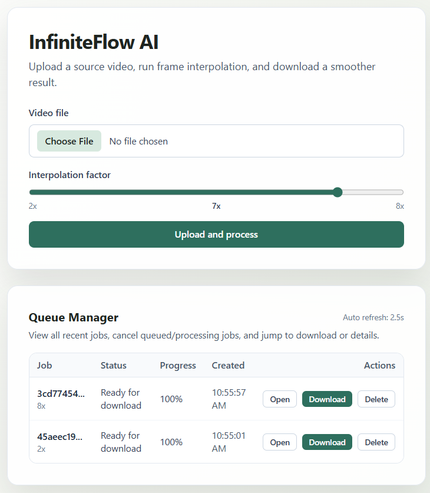
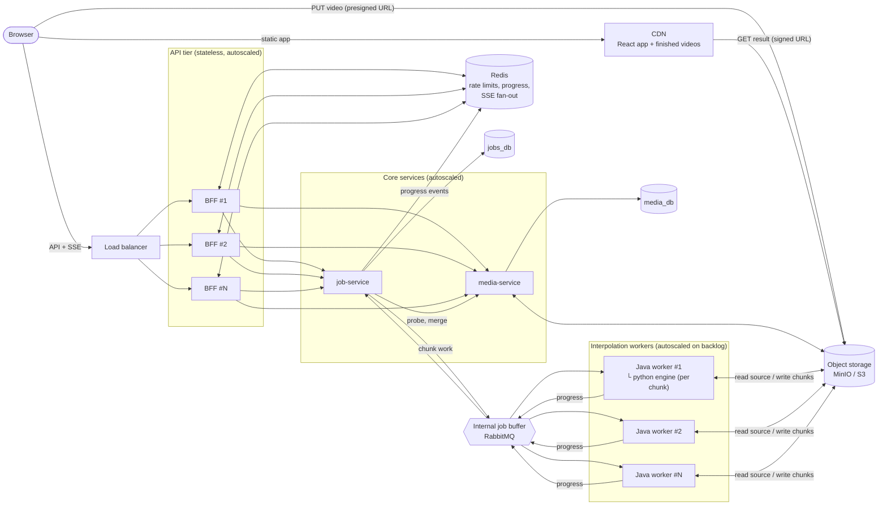
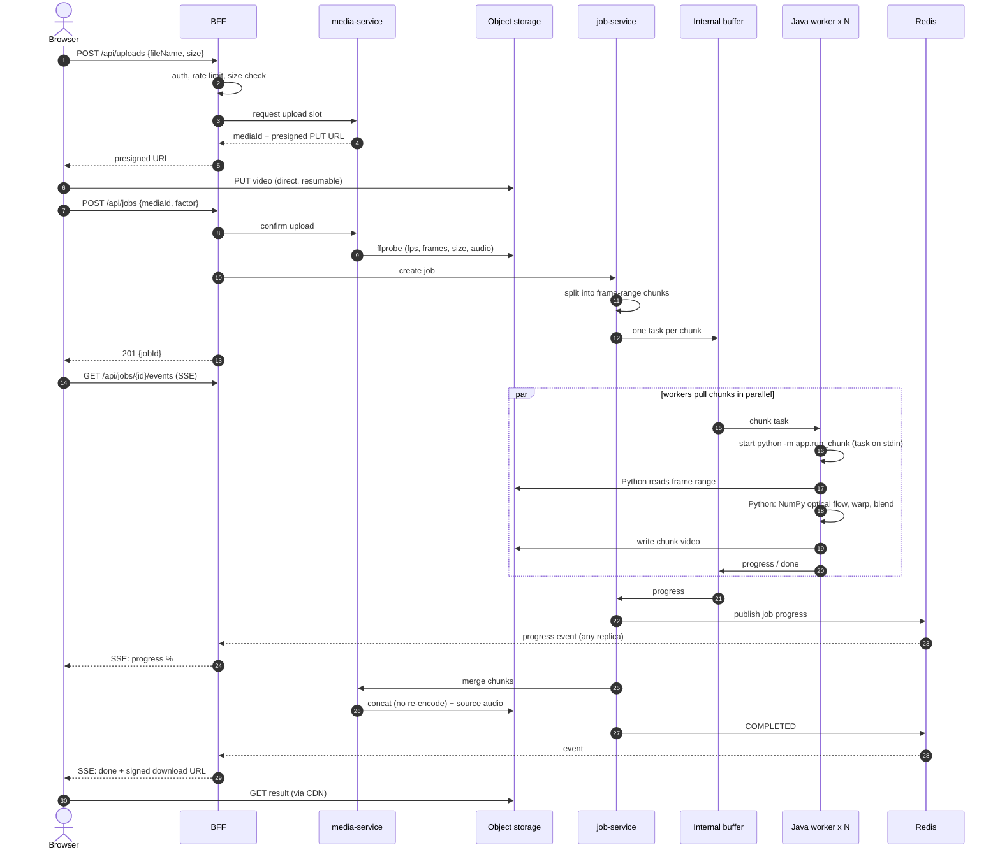
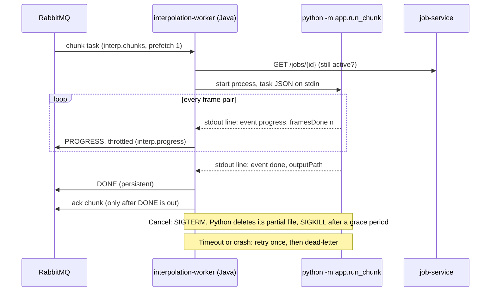
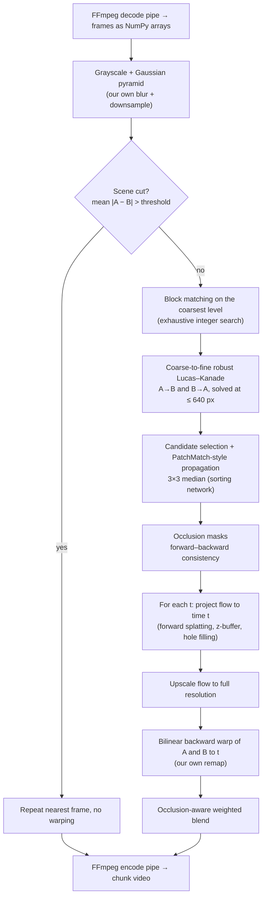
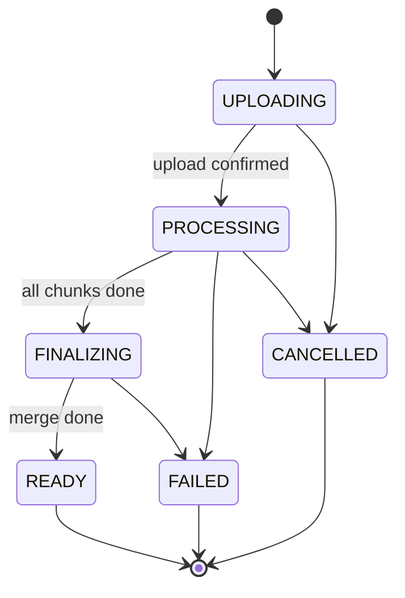

# InfiniteFlow AI - Video Frame Interpolation

Upload a video, pick a factor (2x to 8x), and watch it come back smoother.
InfiniteFlow creates the in-between frames with a **hand-written optical-flow engine in Python (NumPy)**: no pretrained models and no OpenCV flow.




## MVP Scope

What the user does:

1. Upload a video and pick a factor (2x to 8x).
2. Watch a single progress bar.
3. Preview and download the result.

What is **out** of the MVP UI: the queue page, queue management, and the per-chunk grid.
The system still buffers work internally, because that buffer is what lets it absorb millions of users. The user just never sees it.

## Stack

| Part | Tech | Role |
| --- | --- | --- |
| `frontend/` | Vite + React 19 + TypeScript (static, served from a CDN) | Upload → progress → preview/download |
| `backend/` | Express 5 + TypeScript | **BFF / API**: auth, rate limits, the only public API. Stateless, so it scales horizontally |
| `services/job-service/` | Spring Boot 4 / Java 17 | Owns jobs, splits videos into chunks, tracks progress, triggers the merge |
| `services/media-service/` | Spring Boot 4 / Java 17 + FFmpeg | Presigned upload/download URLs, probe, merge |
| `services/interpolation-worker/` | Spring Boot 4 / Java 17 | Takes chunks from the buffer, runs the Python engine on each, handles retries, cancels, timeouts and progress |
| `services/interpolation-engine/` | **Python + NumPy** (FFmpeg only for frame I/O) | **AI logic only:** hand-written optical flow, flow projection, warping, blending. No server, queue, network or database code |
| Object storage | MinIO locally, S3-compatible in production | Uploads, chunk outputs and final videos |
| Internal buffer | RabbitMQ (hidden from users) | Smooths spikes; workers pull work at their own pace |
| Databases | PostgreSQL 16 (`jobs_db`, `media_db`) | One database per service |
| Cache / pub-sub | Redis | Rate limits, hot job progress, SSE fan-out across BFF replicas |

## System Overview



**Why this scales to millions of users:**

- **Video bytes never pass through our APIs.** The browser uploads straight to object storage with a presigned URL, and downloads come from the CDN. The BFF only handles small JSON requests.
- **Every tier is stateless and scales horizontally.** BFF, job-service and media-service sit behind load balancers and autoscale on CPU and request rate.
- **Workers scale on backlog.** They autoscale (for example with KEDA) on the internal buffer's depth, so a traffic spike makes jobs wait a bit longer instead of crashing anything.
- **Database per service**, with read replicas for the job list and status reads. Job progress is cached in Redis so polling doesn't hit Postgres.
- **Back-pressure:** per-user rate limits and quotas at the BFF (Redis), plus maximum file size and duration checks before any work is queued.
- **SSE works across replicas:** whichever BFF replica a browser connects to receives every job event through Redis pub/sub.

## End-to-End Flow



## Java ↔ Python Boundary

Python does the AI math and nothing else. The Java `interpolation-worker` owns everything a server does: RabbitMQ, acks and retries, cancellation, timeouts, progress reporting and calls to job-service. It runs the Python engine as a child process, once per chunk:



| Python exit code | Meaning | What Java does |
| --- | --- | --- |
| `0` + `done` | Chunk written | Publish DONE, ack |
| `3` + `cancelled` | Stopped by SIGTERM | Ack (job was cancelled) |
| `1` / `2` + `error`, or crash | Processing error / bad task | Retry once, then publish FAILED and dead-letter |

## The Interpolation Engine (hand-written)

All the "AI" is ordinary math written by us in NumPy, with no learned weights. FFmpeg only decodes frames into NumPy arrays and encodes them back to video.



All the math lives in `services/interpolation-engine/app/engine/`. `app/flow.py` wires it together.

| Module | Hand-written piece |
| --- | --- |
| `engine/image.py` | Grayscale (BT.601), central-difference gradients |
| `engine/pyramid.py` | Separable Gaussian blur, box filter (shifted sums / cumulative sums), 2x pyramid |
| `engine/warp.py` | Vectorised bilinear sampling (`remap`) with edge clamping; flow upscaling |
| `engine/flow.py` | Block matching, robust (Charbonnier-weighted) pyramidal Lucas–Kanade, candidate selection, PatchMatch-style propagation, median-of-9 sorting network |
| `engine/occlusion.py` | Forward–backward consistency check (Sundaram et al.) → soft occlusion masks |
| `engine/project.py` | Flow projection to time t (Baker et al.): forward splatting with a z-buffer (photo-consistency + foreground heuristic), hole filling |
| `engine/interpolate.py` | Occlusion-aware warp-and-blend at time t |
| `ffmpeg_io.py` | Raw-frame pipes in and out of FFmpeg (I/O only) |

Quality presets (`FLOW_PRESET`): `medium` (default, best), `fast`, `ultrafast`.

**Measured speed** (one replica, one CPU core for the math, `medium` preset):

| Source | x2 | x4 |
| --- | --- | --- |
| 640×360 | ~1.4 source frames/s | ~1.2 source frames/s |
| 1280×720 | ~1.1 | ~0.7 |
| 1920×1080 | ~1.0 | ~0.5 |

Pure NumPy is roughly 10× slower than OpenCV's C++. We make up for it the microservice way: a video is split into chunks that run in parallel on as many worker replicas as needed, and workers autoscale on backlog.

Chunks overlap by one frame so their boundaries are seamless: concatenating every chunk gives exactly `(N − 1) × factor + 1` frames.

## Job Lifecycle (what the user sees)



Internally job-service still tracks per-chunk state for retries and crash recovery. The UI shows one progress bar.

## Public API (BFF)

| Method | Path | Description |
| --- | --- | --- |
| `POST` | `/api/uploads` | Get a presigned upload URL for a new video |
| `POST` | `/api/jobs` | `{mediaId, factor}`: start interpolation |
| `GET` | `/api/jobs` | The user's own videos (paginated) |
| `GET` | `/api/jobs/{id}` | Status and progress |
| `GET` | `/api/jobs/{id}/events` | SSE stream for that one job |
| `GET` | `/api/jobs/{id}/download` | Redirect to a signed CDN URL |
| `POST` | `/api/jobs/{id}/cancel` | Cancel |
| `DELETE` | `/api/jobs/{id}` | Delete the job and its files |
| `GET` | `/api/health` | Status of every dependency |

## Reliability

- A worker acknowledges a chunk only **after** its output is written and DONE is published. If a worker dies, the chunk is redelivered to another one.
- A failing chunk is retried once, then sent to a dead-letter queue and the job fails cleanly.
- Every step can safely run twice: chunk outputs have fixed names, and duplicate progress messages are ignored.
- Object storage lifecycle rules delete chunk scratch files after 1 day and expired results after N days.

## Quick Start (local)

```bash
docker compose -f infra/docker-compose.yml up --build
docker compose -f infra/docker-compose.yml up -d --scale interpolation-worker=4   # more workers
```

| URL | What |
| --- | --- |
| http://localhost:8080 | App |
| http://localhost:5000/api/health | API health |
| http://localhost:9001 | MinIO console |
| http://localhost:15672 | RabbitMQ console (internal buffer) |

Run the Python engine on its own, with no services (handy for tuning the algorithm):

```bash
cd services/interpolation-engine
python -m app.cli input.mp4 output.mp4 --factor 4
```

## Roadmap

From the current code to this MVP, in order:

1. ~~**Engine: replace OpenCV with hand-written NumPy.**~~ **Done.** Python is limited to AI logic; the Java `interpolation-worker` runs it. `app/engine/` holds the math, `cv2` is gone from the code and the image, and `tests/test_engine.py` checks it against known ground-truth motion.
2. **Frontend: simplify.** Remove the Queue page and the chunk grid. The pages become Upload → Job (progress, preview, download) → My videos.
3. **Storage: move from the shared `/data` volume to object storage.** Add MinIO to compose. media-service issues presigned URLs, and workers read and write through the S3 API.
4. **BFF: scale-ready.** Presigned upload flow, Redis-backed rate limiting, SSE fan-out through Redis pub/sub, and per-job SSE instead of an all-jobs stream.
5. **Hide the buffer.** Keep RabbitMQ internal. Drop the `job.events` → BFF path in favour of Redis, and stop exposing chunk details in the public API.
6. **Production deploy (after the MVP):** Kubernetes with an HPA on the BFF and services, KEDA scaling workers on queue depth, managed Postgres with read replicas, S3 + CDN, and user auth and quotas.
