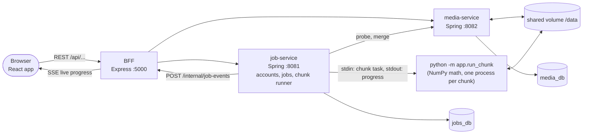
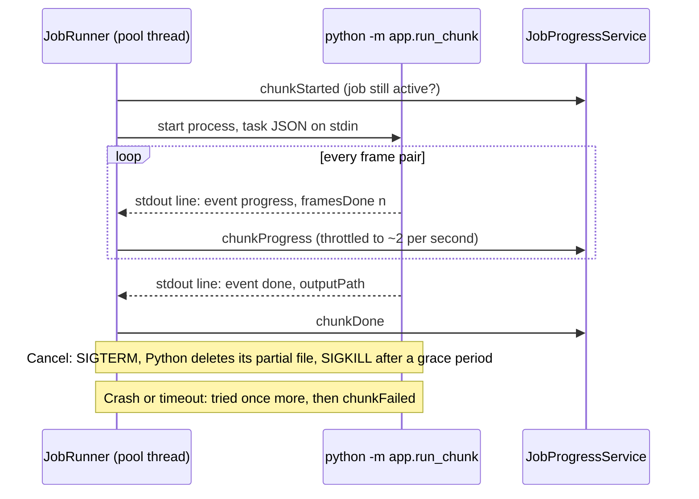
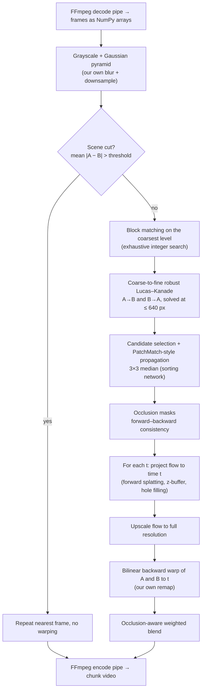
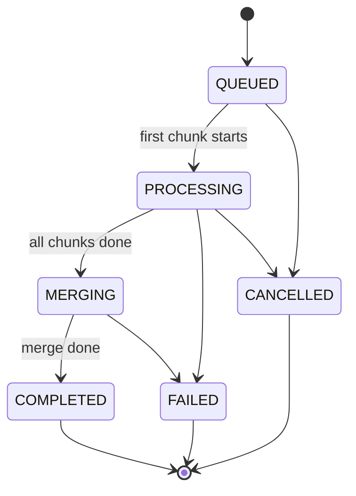

<div align="center">

# InfiniteFlow AI

**Video Frame Interpolation**

Upload a video, pick a factor (2x to 8x), and watch it come back smoother.

Hand-written optical-flow engine powered by **Python + NumPy**. No pretrained models. No OpenCV flow.

## [Landing Page](https://jianofreo.onrender.com/infiniteflow)

[](https://www.python.org/)
[](https://numpy.org/)
[](https://react.dev/)
[](https://www.typescriptlang.org/)
[](https://spring.io/projects/spring-boot)
[](https://www.postgresql.org/)

</div>

---

<div align="center">
  <!--  -->

  

  
</div>


---

## What the user does

1. Open the app. No account needed: the browser gets a private guest id.
2. Drop a video, pick a factor (2x to 8x), optionally pick pre-processing (denoise, deband, sharpen), press **Create**.
3. Watch the progress, then preview and download the result.
4. Every video becomes an entry in the sidebar history, like chats in ChatGPT.

**Plans and limits.** Like an AI product, every plan has a daily allowance. Usage is counted in seconds of source video over a rolling 24 hours (failed jobs don't count, cancelled ones do). A guest keeps the history in that browser and is also counted per network address, so clearing the browser doesn't reset the allowance. Signing up keeps the history on every device and moves the guest videos into the account. **Pro** is a monthly Stripe subscription with much higher, still capped, limits.

| Plan | Per day | Longest clip | Highest factor | At once |
| --- | --- | --- | --- | --- |
| Guest | 30 s | 10 s | 2x | 1 |
| Free account | 3 min | 30 s | 4x | 2 |
| Pro | 30 min | 3 min | 8x | 5 |

The limits are `PLAN_*` settings on job-service (`app.plans.*`), enforced in `QuotaService`. The BFF checks the cheap ones (factor, allowance left, videos running) before the upload starts, so nobody uploads a big file only to be refused; job-service checks the clip length once media-service has probed the video.

**Billing (Stripe).** Only the BFF talks to Stripe. `POST /api/billing/checkout` opens Stripe Checkout for the Pro price, `POST /api/billing/portal` opens Stripe's billing portal, and Stripe's webhook (`POST /api/billing/webhook`, signature-checked, raw body) reports subscription changes. For each event the BFF re-reads the subscription from Stripe (events can arrive out of order) and stores plan and status on the account in job-service. Pro limits apply only while the subscription is `active` or `trialing`. Without `STRIPE_SECRET_KEY` and `STRIPE_PRICE_PRO`, billing is off and everyone is guest or free. Setup: [infra/DEPLOY_AWS.md](infra/DEPLOY_AWS.md#6-stripe-optional-for-the-pro-plan).

## Stack

| Part | Tech | Role |
| --- | --- | --- |
| `frontend/` | Vite + React 19 + TypeScript | The app: upload, history sidebar, job page, settings, light/dark theme |
| `backend/` | Express 5 + TypeScript | **BFF**, the only API the browser talks to. Checks who is calling (guest id or login token), forwards to the services, and pushes live progress to browsers over SSE. No database |
| `services/job-service/` | Spring Boot 4 / Java 17 | Owns **accounts and jobs**. Splits a video into chunks, runs the Python engine on them (thread pool), tracks progress, triggers the merge |
| `services/media-service/` | Spring Boot 4 / Java 17 + FFmpeg | Stores files, probes videos, merges chunks |
| `services/interpolation-engine/` | **Python + NumPy** (FFmpeg only for frame I/O) | **AI logic only:** hand-written optical flow, warping, blending. No server, network or database code |
| Databases | PostgreSQL 16 (`jobs_db`, `media_db`) | One database per service |

There is **no message queue**. job-service runs the engine itself on a fixed pool of threads: when more chunks are waiting than there are threads, the extra ones simply wait their turn in memory.

## System Overview



## How one video flows through the system

Where to read the code is in brackets.

1. **Identify.** Every request carries either a login token or the browser guest id. The BFF turns that into an owner: `u:<userId>` or `g:<guestId>` [`backend/src/middlewares/identity.middleware.ts`].
2. **Upload.** `POST /api/jobs?factor=4&mode=flow&preprocess=denoise` streams the file straight through the BFF to media-service, which stores and probes it (fps, frames, size, audio) [`backend/src/controllers/job/postRequests.controller.ts`].
3. **Create the job.** The BFF asks job-service to create the job. job-service first checks the plan limits (videos running, factor, clip length, what is left of today's allowance), then plans chunks of about 2 seconds [`services/job-service/.../service/JobService.java`, `ChunkPlanner.java`].
4. **Run the chunks.** `JobRunner` hands one task per chunk to the thread pool. Each free thread starts `python -m app.run_chunk` for its chunk, sends the task as JSON on stdin and reads progress lines from stdout. A failing chunk is retried once, then the job fails [`JobRunner.java`, `EngineRunner.java`].
5. **Track progress.** After every change (`chunkStarted`, `chunkProgress`, `chunkDone`, `chunkFailed`) `JobProgressService` updates the database and tells the BFF [`JobProgressService.java`, `JobEventPublisher.java`].
6. **Live update.** job-service posts the event to the BFF (`POST /internal/job-events`, protected by a shared key). The BFF's SSE hub forwards it only to the browsers of that job owner [`backend/src/services/job-sse/`].
7. **Merge.** When the last chunk finishes, `MergeService` asks media-service to join the chunks without re-encoding and put the audio back. The job becomes `COMPLETED`.
8. **Download.** `GET /api/jobs/{id}/download` streams the result with Range support so the player can seek.

If job-service restarts while videos are running, those jobs are marked failed on startup (their work was in memory), and the user uploads again.

## Java ↔ Python boundary

Python does the AI math and nothing else. job-service owns everything a server does: threads, retries, cancelling, timeouts and progress. It runs the Python engine as a child process, once per chunk:



| Python exit code | Meaning | What job-service does |
| --- | --- | --- |
| `0` + `done` | Chunk written | `chunkDone` |
| `3` + `cancelled` | Stopped by SIGTERM | Nothing (the job was cancelled) |
| `1` / `2` + `error`, or crash | Processing error / bad task | Retry once, then `chunkFailed` and the job fails |

## The Interpolation Engine (hand-written)

All the "AI" is ordinary math written by us in NumPy, with no learned weights. FFmpeg only decodes frames into NumPy arrays and encodes them back to video.



All the math lives in `services/interpolation-engine/app/engine/`. `app/flow.py` wires it together.

| Module | Hand-written piece |
| --- | --- |
| `engine/image.py` | Grayscale (BT.601), central-difference gradients |
| `engine/pyramid.py` | Separable Gaussian blur, box filter (shifted sums / cumulative sums), 2x pyramid |
| `engine/warp.py` | Vectorised bilinear sampling (`remap`) with edge clamping; flow upscaling |
| `engine/flow.py` | Block matching, robust (Charbonnier-weighted) pyramidal Lucas–Kanade, candidate selection, PatchMatch-style propagation, median-of-9 sorting network |
| `engine/occlusion.py` | Forward–backward consistency check (Sundaram et al.) → soft occlusion masks |
| `engine/project.py` | Flow projection to time t (Baker et al.): forward splatting with a z-buffer (photo-consistency + foreground heuristic), hole filling |
| `engine/interpolate.py` | Occlusion-aware warp-and-blend at time t |
| `ffmpeg_io.py` | Raw-frame pipes in and out of FFmpeg (I/O only) |

Quality presets (`FLOW_PRESET`): `medium` (default, best), `fast`, `ultrafast`.

**Measured speed** (one engine thread, one CPU core for the math, `medium` preset):

| Source | x2 | x4 |
| --- | --- | --- |
| 640×360 | ~1.4 source frames/s | ~1.2 source frames/s |
| 1280×720 | ~1.1 | ~0.7 |
| 1920×1080 | ~1.0 | ~0.5 |

Pure NumPy is roughly 10× slower than OpenCV's C++. We make up for it by splitting a video into chunks that run in parallel on the engine thread pool (`ENGINE_THREADS`), and by running more than one job-service instance when one machine is not enough.

Chunks overlap by one frame so their boundaries are seamless: concatenating every chunk gives exactly `(N − 1) × factor + 1` frames.

## Job lifecycle



`QUEUED` only means "waiting for a free engine thread". Progress 0-95% is the chunks, the last 5% is the merge.

## Public API (BFF)

Every `/api/jobs` call needs identity: `Authorization: Bearer <token>` or `X-Guest-Id: <id>` (`?token=` / `?guest=` for `<video>` and download links). A job that belongs to someone else answers 404.

| Method | Path | Description |
| --- | --- | --- |
| `POST` | `/api/auth/register` | `{email, password, name?}`: create an account, get a token. Guest videos move into it |
| `POST` | `/api/auth/login` | `{email, password}`: get a token. Guest videos move into the account |
| `POST` | `/api/jobs?factor=&mode=&preprocess=` | Upload a video (multipart `file`) and start the job |
| `GET` | `/api/jobs` | The caller's own videos |
| `GET` | `/api/jobs/{id}` | Status, progress and chunks |
| `GET` | `/api/jobs/stream` | SSE: live updates for the caller's jobs |
| `GET` | `/api/jobs/{id}/download` | The finished video (Range supported) |
| `PATCH` | `/api/jobs/{id}/cancel` | Cancel |
| `DELETE` | `/api/jobs/{id}` | Delete the job and its files |
| `GET` | `/api/usage` | The caller's plan, today's usage and every plan's limits |
| `POST` | `/api/billing/checkout` | Account only: `{url}` of a Stripe Checkout page for Pro |
| `POST` | `/api/billing/portal` | Account only: `{url}` of Stripe's billing portal |
| `POST` | `/api/billing/webhook` | Stripe only (signed): subscription changes |
| `GET` | `/api/health` | Status of every dependency |
| `POST` | `/internal/job-events` | job-service only (shared key): "this job changed" |

## Reliability

- A failing chunk is retried once; a second failure fails the job with a readable reason and stops its other chunks.
- Cancelling stops the running engines (SIGTERM, then SIGKILL) and makes waiting chunks skip themselves.
- A slow or missing BFF never slows the engine: live updates are fire-and-forget on their own thread, and the browser reloads from REST whenever it reconnects or a job changes status.
- A chunk that runs longer than `CHUNK_TIMEOUT_MINUTES` is killed.
- Jobs interrupted by a restart are marked failed on startup instead of staying "processing" forever.
- Chunk outputs are written to `<name>.part` and renamed when complete, so a half-written chunk is never merged.

## Run it

```bash
docker compose -f infra/docker-compose.yml up --build      # app on http://localhost:8080
```

Set `AUTH_SECRET` (signs login tokens) and `INTERNAL_KEY` (job-service to BFF) to long random values before exposing it. `ENGINE_THREADS` on job-service is how many chunks run at once.
