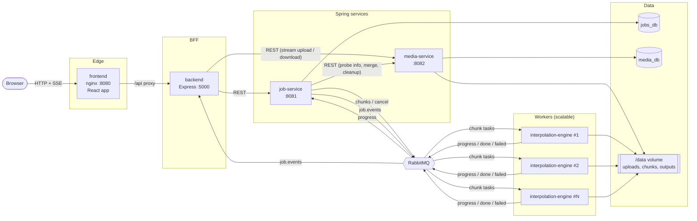
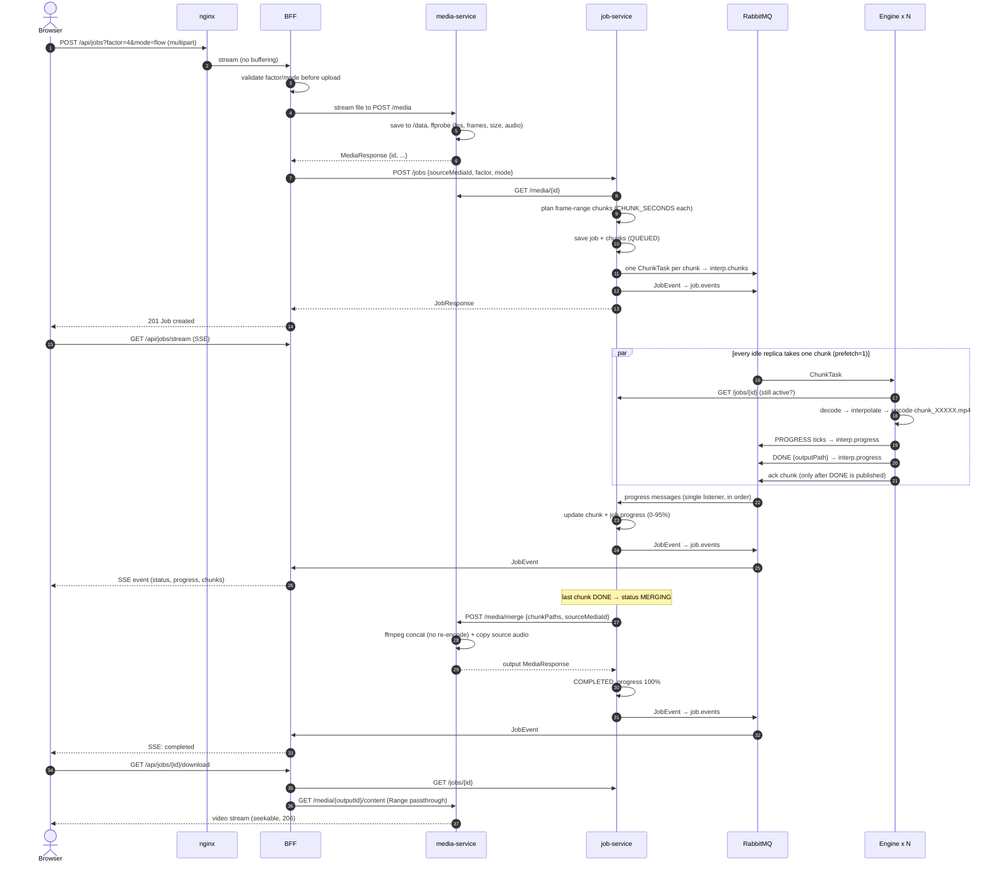
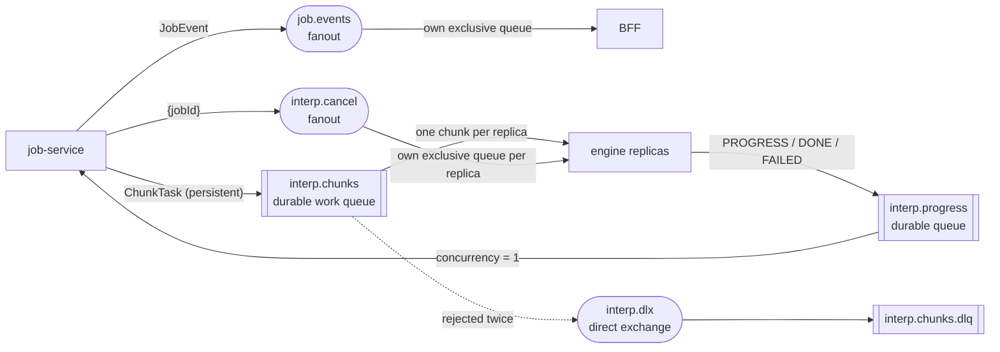
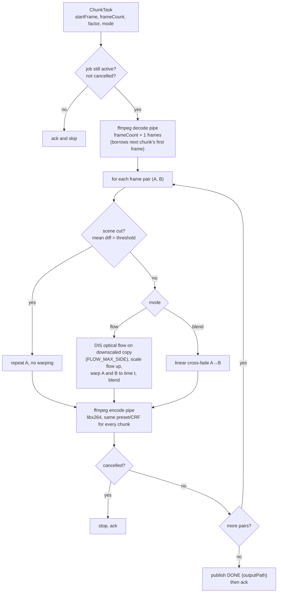
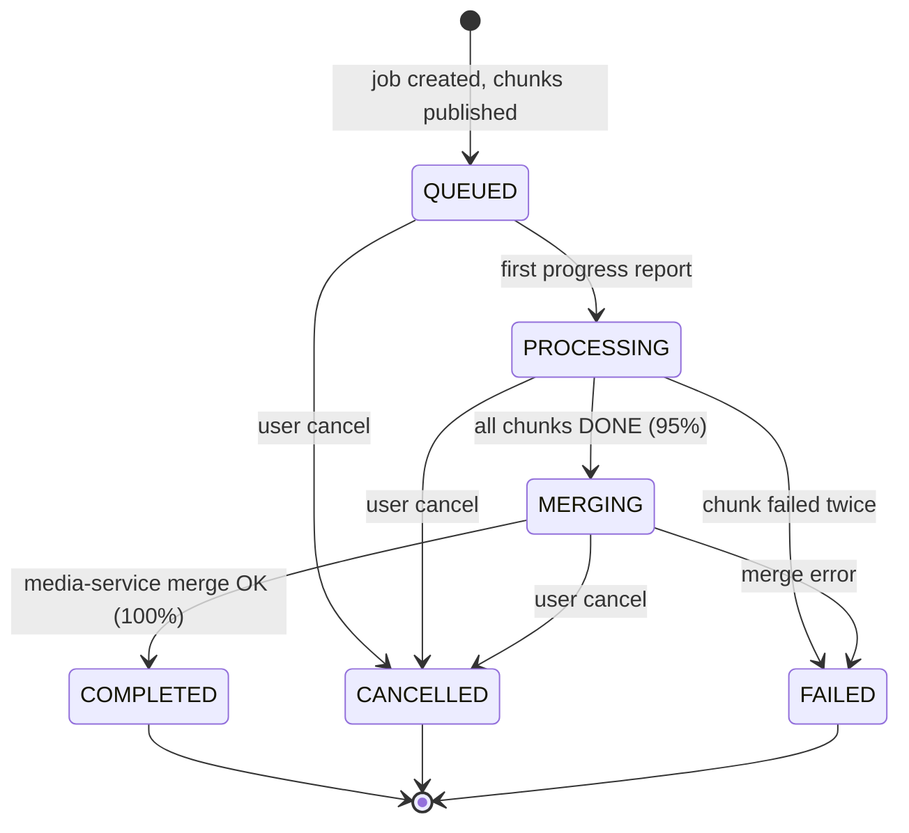

# InfiniteFlow AI - Distributed Video Frame Interpolation

Upload a video, pick a factor (2x to 8x), and InfiniteFlow generates the in-between frames using optical flow.
The work is split into chunks and spread across as many engine replicas as you run, with live progress in the browser.


## Stack

| Part | Tech | Role |
| --- | --- | --- |
| `frontend/` | Vite + React 19 + TypeScript, served by nginx | Upload, queue, job details, live progress |
| `backend/` | Express 5 + TypeScript | **BFF** (backend for frontend): the only API the browser talks to |
| `services/job-service/` | Spring Boot 4 / Java 17 | Owns jobs and chunks, plans work, tracks progress, triggers the merge |
| `services/media-service/` | Spring Boot 4 / Java 17 + FFmpeg | Stores, probes, streams, and merges video files |
| `services/interpolation-engine/` | Python + OpenCV + FFmpeg | Decodes a frame range, interpolates it (DIS optical flow or blend), encodes it |
| `infra/` | Docker Compose, PostgreSQL 16, RabbitMQ 4 | Runs the whole stack |

## System Overview



Key rules:

- The browser only ever reaches **nginx → BFF**. The Spring services and the engine are internal.
- **Database per service:** job-service owns `jobs_db`, media-service owns `media_db`. Neither reads the other's database.
- Video bytes live on a shared `/data` volume. Services pass **paths and IDs**, never file contents, over RabbitMQ.
- Engines are stateless. Add more with `--scale interpolation-engine=N`.

## End-to-End Flow



## RabbitMQ Topology



| Name | Type | From → To | Purpose |
| --- | --- | --- | --- |
| `interp.chunks` | queue | job-service → engines | One message per chunk. Work-queue: each chunk goes to exactly one replica. |
| `interp.chunks.dlq` | queue (via `interp.dlx`) | — | Chunks that failed twice. |
| `interp.progress` | queue | engines → job-service | Progress ticks, `DONE`, `FAILED`. |
| `interp.cancel` | fanout | job-service → every engine | Stop all chunks of a job within one frame pair. |
| `job.events` | fanout | job-service → BFF | Job changes relayed to browsers over SSE. |

## Inside the Engine



Chunks overlap by one frame so their boundaries are seamless: concatenating every chunk gives exactly
`(N - 1) × factor + 1` frames, the same as processing the whole video in one go (checked in `tests/test_pipeline.py`).

## Job Lifecycle



Each chunk has its own small lifecycle: `PENDING → PROCESSING → COMPLETED` (or `FAILED`).
The job details page shows the chunk grid and which engine replica took each chunk.

## Reliability

- **Crash-safe chunks:** an engine acks a chunk only after its `DONE` report is published. If a replica dies mid-chunk, RabbitMQ redelivers it to another replica.
- **One retry:** a failing chunk is requeued once; the second failure reports `FAILED`, goes to the DLQ, and fails the job.
- **Ordered progress:** job-service consumes `interp.progress` with a single listener, so "was that the last chunk?" can't race. Duplicate or late messages are ignored.
- **Optimistic locking:** cancel and progress updates retry if they collide on the same job row.
- **Cleanup:** cancel/fail/delete remove the job's work directory; if job creation fails, the BFF deletes the uploaded file.
- **Lossy where it's safe:** progress ticks and `job.events` are non-persistent; the UI refetches if one is lost.

## Public API (BFF)

All routes are under `/api` and served through nginx on port 8080.

| Method | Path | Description |
| --- | --- | --- |
| `GET` | `/api/health` | Status of BFF, job-service, media-service and RabbitMQ (503 if any is down) |
| `POST` | `/api/jobs?factor=2..8&mode=flow\|blend` | Upload a video (`multipart/form-data`, field `file`) and create a job |
| `GET` | `/api/jobs?limit=50&activeOnly=false` | List recent jobs |
| `GET` | `/api/jobs/stream` | Server-Sent Events stream of job changes |
| `GET` | `/api/jobs/{job_id}` | Job details with per-chunk progress |
| `GET` | `/api/jobs/{job_id}/download` | Stream the output video (supports `Range`; add `?attachment=1` to download) |
| `PATCH` | `/api/jobs/{job_id}/cancel` | Cancel a queued/processing/merging job |
| `DELETE` | `/api/jobs/{job_id}` | Delete a job and its files |

Internal service APIs (not reachable from the browser):

- **job-service** `:8081` — `POST /jobs`, `GET /jobs`, `GET /jobs/{id}`, `GET /jobs/{id}/chunks`, `POST /jobs/{id}/cancel`, `DELETE /jobs/{id}`
- **media-service** `:8082` — `POST /media`, `GET /media/{id}`, `GET /media/{id}/content`, `POST /media/merge`, `DELETE /media/{id}`, `DELETE /media/workdirs/{jobId}`

## Quick Start

From the project root:

```bash
docker compose -f infra/docker-compose.yml up --build
```

Run more engine replicas to process more chunks in parallel:

```bash
docker compose -f infra/docker-compose.yml up -d --scale interpolation-engine=4
```

| URL | What |
| --- | --- |
| http://localhost:8080 | App |
| http://localhost:5000/api/health | BFF health |
| http://localhost:15672 | RabbitMQ management (guest / guest) |

### Frontend dev server

With the stack running, the BFF is exposed on `:5000`, so you can run the frontend with hot reload:

```bash
cd frontend
npm install
npm run dev   # http://localhost:5173
```

## Configuration

| Service | Variable | Default | Meaning |
| --- | --- | --- | --- |
| job-service | `CHUNK_SECONDS` | `2` | Seconds of source video per chunk |
| job-service, media-service | `DB_URL` | see compose | JDBC URL for its own database |
| job-service, media-service | `FILE_ROOT` | `/data` | Shared storage root |
| engine | `FLOW_PRESET` | `medium` | DIS preset: `ultrafast`, `fast`, `medium` |
| engine | `FLOW_MAX_SIDE` | `640` | Longest side used for flow estimation |
| engine | `SCENE_CUT_THRESHOLD` | `40` | Mean frame difference treated as a cut |
| engine | `X264_PRESET` / `X264_CRF` | `veryfast` / `18` | Chunk encoder settings (must match across chunks) |
| engine | `PROGRESS_INTERVAL` | `0.5` | Seconds between progress reports |
| BFF | `CORS_ORIGIN` | `http://localhost:8080,http://localhost:5173` | Allowed origins |

Postgres runs one instance with two databases, `jobs_db` and `media_db` (user `app` / password `app`), created by `infra/postgres/init-databases.sql`.

## Why It's Fast and Lightweight

- **CPU only:** no GPU, no model weights, no inference runtime.
- **Parallel by chunk:** throughput scales roughly with the number of engine replicas.
- **Flow on a small copy:** motion is estimated at ≤640 px and scaled up; the warp still uses full-resolution pixels.
- **Streaming everywhere:** uploads stream nginx → BFF → media-service; frames stream through ffmpeg pipes; downloads stream with Range support.
- **No re-encode on merge:** chunks are joined with ffmpeg's concat demuxer.
